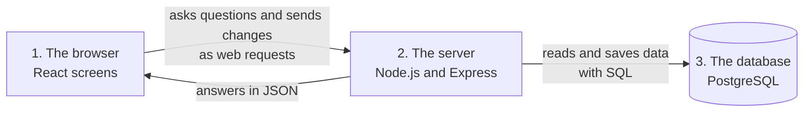
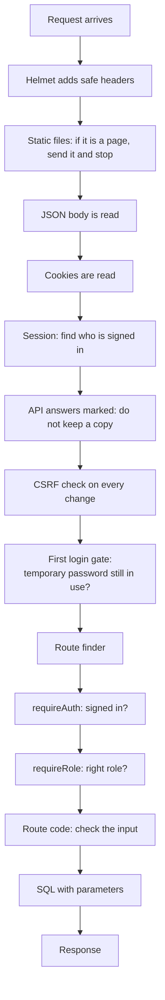

# Architecture

This page explains how the parts of the project fit together and how one request travels through the system. It is written for curious readers, so every technical word is explained.

## The three parts

An app like this has three parts. Each one has one job.



* **The browser** shows the screens. It never touches the database.
* **The server** is the boss. It decides who you are, what you may do, and whether the data is valid.
* **The database** keeps the data safe on disk.

Why not let the browser talk to the database directly? Because anyone can open the browser tools and change what the browser sends. The server is the only part we control, so every rule lives there.

## Words used on this page

* **Request and response.** The browser sends a request ("show me my training"). The server sends back a response (the data, or an error).
* **JSON.** A simple text format for data, such as `{ "status": "Completed" }`. Browsers and servers both understand it.
* **REST API.** A set of web addresses, such as `/api/v1/activities`, that each do one clear job. The word REST means the address names the thing, and the method (GET, POST, PUT, PATCH) names the action.
* **Middleware.** A small step that every request passes through before it reaches the real code. For example, a step that checks you are signed in.

## How the pages reach your browser

There are two situations.

**On your own computer (development).** Two programs run side by side. Vite serves the React screens on port 5173, and Express serves the API on port 4000. Vite is set up to pass every address that starts with `/api` on to Express. The browser sees one address, so login cookies work without extra settings.

**On the live site (production).** One program runs. Express serves the API and also hands out the built React files from `client/dist`. This is switched on with the setting `SERVE_CLIENT=true`. One website, one address, one secure connection.

## The journey of one request

Every request goes through the same checkpoints, in this order. This list matches the order in `server/src/app.js`.



If any checkpoint says no, the request stops there and the matching error is sent. For example, a signed out visitor stops at `requireAuth` with a 401 answer.

## A full example: a candidate saves a status

Follow one action from click to saved data.

1. The candidate picks "Completed" in the list and clicks Save.
2. The React screen (`CandidateHome.jsx`) calls `api.patch(...)`.
3. `client/src/api.js` first asks the server for a fresh CSRF token. This is a one time proof that the request comes from our own screens.
4. It then sends `PATCH /api/v1/assignments/5/status` with the token and `{ "status": "Completed" }`.
5. The server checks the safe headers, reads the session cookie, and confirms the CSRF token.
6. The first login gate confirms the candidate already chose a real password.
7. `requireAuth` confirms the person is signed in. `requireRole('Candidate')` confirms they are a candidate.
8. The route in `assignments.js` checks that the status is one of the three allowed words.
9. It finds the assignment, then finds who the signed in person is **from the session**, not from the request. If the assignment belongs to someone else, it answers 403.
10. It saves the change with an SQL update that also repeats the owner check.
11. It sends back the updated assignment, and the screen shows "Saved".

Step 9 is the heart of the security design. The server never trusts a person's id sent by the browser.

## Where the code lives

```
learning-progress-tracker/
  package.json        Build and start commands used by the host
  client/             The React screens
    src/
      App.jsx         Decides which screen to show
      api.js          The only place that talks to the server
      useLoad.js      A small helper that loads data and tracks loading and errors
      pages/          One file per screen
      components/     Shared pieces: top bar, buttons, fields, banners
  server/             The API
    src/
      server.js       Starts the server on a port
      app.js          Builds the app and lists the checkpoints in order
      db.js           The connection pool to PostgreSQL
      csrf.js         CSRF protection setup
      utils.js        Small helpers: id checks, temporary passwords, answer shapes
      middleware/     requireAuth, requireRole and the first login gate
      routes/         auth, learners, activities, assignments, me, summary
    db/               schema.sql and the setup scripts
    tests/            Automated tests
    scripts/          Quick manual check scripts
  docs/               The documents you are reading
```

### What each server file does

| File | Job |
| --- | --- |
| `app.js` | Puts every checkpoint in the right order and connects each address to its route file |
| `db.js` | Opens a pool of database connections and survives a closed idle connection |
| `csrf.js` | Creates and checks CSRF tokens. The secret is made from `SESSION_SECRET`, so only one secret is needed |
| `middleware/auth.js` | `requireAuth`, `requireRole` and the first login gate |
| `routes/auth.js` | Login, who am I, change password, logout, CSRF token |
| `routes/learners.js` | List candidates, add a candidate, reset a password, see one candidate's progress |
| `routes/activities.js` | List, add and edit activities |
| `routes/assignments.js` | Assign an activity, update a status |
| `routes/me.js` | My Training for the signed in candidate |
| `routes/summary.js` | Cohort totals |

### What each screen file does

| File | Job |
| --- | --- |
| `LoginPage.jsx` | The sign in form |
| `ChangePasswordPage.jsx` | The forced password change screen |
| `CoordinatorDashboard.jsx` | Totals and the two tabs |
| `ActivitiesPanel.jsx` | Add and edit activities |
| `CandidatesPanel.jsx` | Add candidates, pick one, show credentials |
| `LearnerDetail.jsx` | One candidate: progress bar, assignments, reset password |
| `CandidateHome.jsx` | My Training |

## Design choices and the reasons

| Choice | Reason |
| --- | --- |
| Plain SQL, no ORM | The data is small and the rules are database rules. Writing SQL by hand keeps them visible and easy to explain |
| Sessions in PostgreSQL | Signing out and password resets can really end a session. A restart does not sign everyone out |
| Cookie sessions, not tokens in the page | An HttpOnly cookie cannot be read by page scripts, which makes theft harder |
| One server for pages and API | One address and one HTTPS site. Simpler to host for free |
| Server checks everything | The browser can be changed by anyone, so it can never be the only guard |
| Totals counted every time | A stored total can drift away from the real data. A counted total cannot |
| Maintained security libraries | Home made security code is risky. We use well known packages instead |

## How to add a new feature

A short recipe, using "notes on an assignment" as an example.

1. Add the column or table to `server/db/schema.sql`, with CHECK rules.
2. Add or change a route file in `server/src/routes/`. Check the input first. Use SQL parameters like `$1`, never string joining.
3. If it is a new route file, connect it in `app.js` with the right `requireRole`.
4. Write tests in `server/tests/`, including a test that the wrong role is refused.
5. Add the screen part in `client/src/pages/` and call it through `api.js`.
6. Document the new address in [API](API.md).

## Where to go next

* [Data model](DATA_MODEL.md) for the tables.
* [API reference](API.md) for every address.
* [Security](SECURITY.md) for the protection layers in depth.
