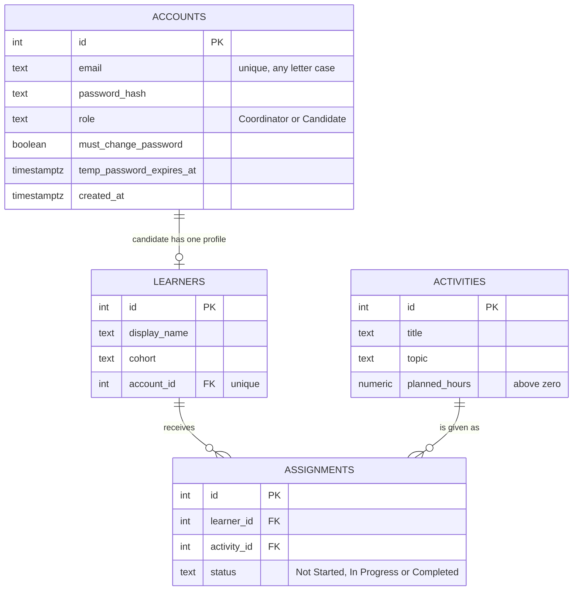

# Data model and stack choices

This page explains how the data is organised and why. It is written to be read aloud in a demo.

## The picture

A fifth table, `session`, stores login sessions for the session library. It is not part of the business data.

In this project, candidate and learner mean the same person.

## The tables in plain words

* **accounts** holds everything needed to sign in: the email, the password hash, the role, whether the person must change their password, and when a temporary password expires. A coordinator is just an account with the Coordinator role.
* **learners** holds the training profile of a candidate: display name and cohort. Each profile points to exactly one account.
* **activities** holds the things that can be taught: a title, a topic and the planned hours.
* **assignments** joins a learner to an activity and records progress as a status.

## Rules, and where they are enforced

Each rule is enforced twice. The API checks it first and gives a friendly message. The database checks it again, so bad data is refused even if the API has a bug.

* Planned hours must be above zero. API check, plus a CHECK rule on the column.
* Title, topic, name and cohort cannot be empty or only spaces. API check, plus CHECK rules.
* The email is unique, ignoring letter case. The API saves it in lower case, and a unique index on LOWER(email) backs it up.
* An activity can be given to a learner only once. A UNIQUE rule on the pair learner_id and activity_id. A second try gives a 409 answer.
* The status can only be one of the three allowed words. API check, plus a CHECK rule.
* References must be real. Foreign keys make the database refuse an assignment for a learner or activity that does not exist.
* The role can only be Coordinator or Candidate. A CHECK rule.

## Why it is shaped this way

* **Accounts and learners are separate tables.** Sign in details and training details change for different reasons. A coordinator needs to sign in but has no training, so having no learner row is natural. It also means a learner list can never accidentally include password data.
* **Status is saved on the assignment, not on the activity.** The same activity can be Completed for one person and Not Started for another.
* **The cohort totals are never stored.** The server counts learners, assignments and completed assignments from the saved rows every time, so the numbers cannot drift away from the data. After a page refresh they are still correct.
* **Deleting is careful.** Removing an account also removes its learner profile and assignments (CASCADE). An activity that is still assigned cannot be removed (RESTRICT), so nobody loses progress by accident. The app has no delete screens, but the database stays safe.
* **Temporary passwords carry an expiry and a flag.** `must_change_password` is what locks a new candidate to the password change screen. `temp_password_expires_at` makes a handed over password useless after 24 hours. Both are cleared when the candidate chooses a new password.
* **Identity comes from the session.** The learner is found from `accounts.id` stored in the session, never from an id the browser sends. That is why one candidate cannot read or change another candidate's training.

## Stack choices

The brief asks for the JavaScript full stack track.

* **React and Vite** for the screens, because React is the course frontend and Vite is quick to run and build.
* **Node.js and Express** for the REST API, because they apply the JavaScript backend courses and keep the API a thin, readable layer.
* **PostgreSQL with plain SQL through pg.** The data is small and relational, and the rules above are naturally database rules. Writing the SQL by hand keeps every rule visible and easy to explain. An ORM would have hidden them.
* **Maintained security libraries** (`bcrypt`, `express-session`, `connect-pg-simple`, `csrf-csrf`, `helmet`, `express-rate-limit`) instead of home made code, as the brief requires. Sessions live in PostgreSQL, so signing out and password resets can end sessions for real.
* **Jest and Supertest** for tests, with a separate test database so tests can erase data safely.
