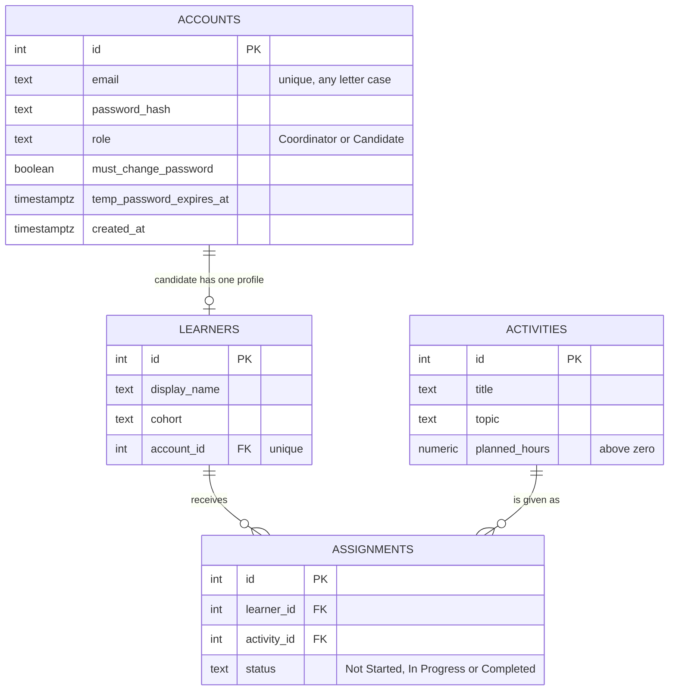

# Data model and stack choices

This page explains how the data is organised and why. It is written to be read aloud in a demo.

A **data model** is the plan of what is stored and how the pieces connect. Our data lives in PostgreSQL, in tables. A table is like a spreadsheet with fixed columns, and each row is one record.

## The picture

How to read the lines: one account has at most one learner profile. One learner has many assignments. One activity can be given as many assignments, one for each learner.

A fifth table, `session`, stores login sessions for the session library. It is not part of the business data.

In this project, candidate and learner mean the same person.

## The tables in plain words

* **accounts** holds everything needed to sign in: the email, the password hash, the role, whether the person must change their password, and when a temporary password expires. A coordinator is just an account with the Coordinator role.
* **learners** holds the training profile of a candidate: display name and cohort. Each profile points to exactly one account.
* **activities** holds the things that can be taught: a title, a topic and the planned hours.
* **assignments** joins a learner to an activity and records progress as a status.
* **session** holds one row per signed in browser: a random id, the session data and an expiry time.

## Column by column

### accounts

| Column | Meaning | Rules |
| --- | --- | --- |
| `id` | Automatic number | Primary key |
| `email` | Sign in name | Saved in lower case. Unique ignoring letter case |
| `password_hash` | The bcrypt hash | Never a readable password |
| `role` | What the person may do | Only `Coordinator` or `Candidate` |
| `must_change_password` | Locks the person to the password change screen | True for new candidates and after a reset |
| `temp_password_expires_at` | When a temporary password stops working | Empty after the person chooses their own |
| `created_at` | When the account was made | Filled automatically |

### learners

| Column | Meaning | Rules |
| --- | --- | --- |
| `id` | Automatic number | Primary key |
| `display_name` | The candidate's name | Not empty |
| `cohort` | The group | Not empty |
| `account_id` | Which account this profile belongs to | Must exist. Each account has at most one profile |

### activities

| Column | Meaning | Rules |
| --- | --- | --- |
| `id` | Automatic number | Primary key |
| `title` | Name of the activity | Not empty |
| `topic` | Subject area | Not empty |
| `planned_hours` | Expected hours | Above zero, up to two decimals |

### assignments

| Column | Meaning | Rules |
| --- | --- | --- |
| `id` | Automatic number | Primary key |
| `learner_id` | Who it was given to | Must exist |
| `activity_id` | Which activity | Must exist |
| `status` | Progress | `Not Started` (the default), `In Progress` or `Completed` |

The pair `learner_id` and `activity_id` must be unique, so the same activity cannot be given to the same person twice.

## A small example

Here is what the data looks like after a coordinator added two candidates and gave one an activity. Names are made up.

| accounts.id | email | role |
| --- | --- | --- |
| 1 | coordinator@example.com | Coordinator |
| 2 | asha.verma@example.com | Candidate |
| 3 | ravi.menon@example.com | Candidate |

| learners.id | display_name | cohort | account_id |
| --- | --- | --- | --- |
| 1 | Asha Verma | Cohort A | 2 |
| 2 | Ravi Menon | Cohort A | 3 |

| activities.id | title | topic | planned_hours |
| --- | --- | --- | --- |
| 1 | React Basics | Frontend | 6 |

| assignments.id | learner_id | activity_id | status |
| --- | --- | --- | --- |
| 1 | 1 | 1 | In Progress |

The coordinator has an account but no learner row. That is natural, because a coordinator is not being trained.

## Rules, and where they are enforced

Each rule is enforced twice. The API checks it first and gives a friendly message. The database checks it again, so bad data is refused even if the API has a bug.

* Planned hours must be above zero. API check, plus a CHECK rule on the column.
* Title, topic, name and cohort cannot be empty or only spaces. API check, plus CHECK rules.
* The email is unique, ignoring letter case. The API saves it in lower case, and a unique index on LOWER(email) backs it up.
* An activity can be given to a learner only once. A UNIQUE rule on the pair learner_id and activity_id. A second try gives a 409 answer.
* The status can only be one of the three allowed words. API check, plus a CHECK rule.
* References must be real. Foreign keys make the database refuse an assignment for a learner or activity that does not exist.
* The role can only be Coordinator or Candidate. A CHECK rule.

## What happens when something is removed

The app has no delete screens, but the database is built to stay safe if rows are ever removed.

| If you remove... | Then... | Why |
| --- | --- | --- |
| An account | Its learner profile and that learner's assignments are removed too (CASCADE) | No orphan data is left |
| A learner | Their assignments are removed too (CASCADE) | Same reason |
| An activity that is still assigned | The database refuses (RESTRICT) | Nobody loses progress by accident |

## Why it is shaped this way

* **Accounts and learners are separate tables.** Sign in details and training details change for different reasons. A coordinator needs to sign in but has no training, so having no learner row is natural. It also means a learner list can never accidentally include password data.
* **Status is saved on the assignment, not on the activity.** The same activity can be Completed for one person and Not Started for another.
* **The cohort totals are never stored.** The server counts learners, assignments and completed assignments from the saved rows every time, so the numbers cannot drift away from the data. After a page refresh they are still correct.
* **Deleting is careful.** See the table above.
* **Temporary passwords carry an expiry and a flag.** `must_change_password` is what locks a new candidate to the password change screen. `temp_password_expires_at` makes a handed over password useless after 24 hours. Both are cleared when the candidate chooses a new password.
* **Identity comes from the session.** The learner is found from `accounts.id` stored in the session, never from an id the browser sends. That is why one candidate cannot read or change another candidate's training.

## How common actions touch the data

| Action | What happens in the database |
| --- | --- |
| Add a candidate | One new `accounts` row and one new `learners` row, saved together. If either fails, neither is saved |
| Reset a password | `accounts` gets a new hash, the flag is set again and a new 24 hour expiry. That account's `session` rows are deleted |
| Assign an activity | One new `assignments` row with status Not Started |
| Save a status | One `assignments` row changes, and only if it belongs to the signed in learner |
| Show cohort totals | Three counts taken from `learners` and `assignments` |
| Sign in | A `session` row is saved |

## Stack choices

The brief asks for the JavaScript full stack track.

* **React and Vite** for the screens, because React is the course frontend and Vite is quick to run and build.
* **Node.js and Express** for the REST API, because they apply the JavaScript backend courses and keep the API a thin, readable layer.
* **PostgreSQL with plain SQL through pg.** The data is small and relational, and the rules above are naturally database rules. Writing the SQL by hand keeps every rule visible and easy to explain. An ORM would have hidden them.
* **Maintained security libraries** (`bcrypt`, `express-session`, `connect-pg-simple`, `csrf-csrf`, `helmet`, `express-rate-limit`) instead of home made code, as the brief requires. Sessions live in PostgreSQL, so signing out and password resets can end sessions for real.
* **Jest and Supertest** for tests, with a separate test database so tests can erase data safely.

## The file that creates it all

All of this is written in `server/db/schema.sql`. Running `npm run db:init` builds every table from that file. It removes old tables first, so it asks you to type the database name before it does anything.

## Where to go next

* [API reference](API.md) shows how the app reads and saves this data.
* [Security](SECURITY.md) explains how access to it is protected.
