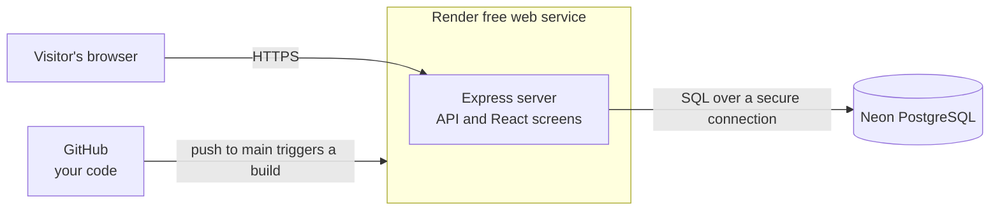

# Deployment

**Deploying** means putting the app on the internet so anyone can open it. This page explains how the live site is built, how to repeat it, and how to keep it healthy. It costs nothing.

Live site: https://learning-progress-tracker-q7rt.onrender.com

## The plan



* **Render** runs the Node server. It also builds the React screens and serves them from the same server.
* **Neon** runs the PostgreSQL database.
* **GitHub** holds the code. Each push to the `main` branch makes Render build and publish a new version by itself.

## What it costs

| Service | Plan | Cost | Important limits |
| --- | --- | --- | --- |
| Render | Free web service | 0 | Sleeps after 15 minutes without visitors. Waking up takes about 1 minute. About 750 hours a month. The disk is temporary |
| Neon | Free | 0 | No credit card. 1 GB of storage. Pauses the database when idle |
| GitHub | Free public repository | 0 | None that matter here |

Plans and limits can change, so check each provider's pricing page before you rely on a number. Do not add a payment method unless you want a paid plan. Without one, the free Render service stops instead of charging.

We did not use Render's own free database, because it expires after 30 days.

## Before you start

* The code is on GitHub and the `main` branch works.
* You have a free account on Render and on Neon.
* You have Node.js and the project installed on your computer. You need it once, to create the tables.

## Step 1. Create the database on Neon

1. Create a new project on Neon. Pick a region close to your Render region (we used AWS Singapore for both).
2. Copy the **connection string**. It is one long address that starts with `postgresql://` and contains the password. Treat it like a password.
3. Never paste it into chat, a document or Git. If it leaks, reset the password in Neon.

## Step 2. Create the tables and the first coordinator

Run these on your computer. The `read -s` line asks you to paste the connection string. Nothing shows on screen while you paste, and that is normal.

```
cd server
read -s DATABASE_URL
export DATABASE_URL
npm run db:init
npm run coordinator:create
```

* `db:init` asks you to type the database name before it does anything. For a new Neon database that is the name in the connection string, after the last slash and before any question mark.
* `coordinator:create` asks for an email and a password, both hidden.
* Close the terminal afterwards, or run `unset DATABASE_URL`, so the secret does not stay in that session.

## Step 3. Create the web service on Render

1. In Render choose **New**, then **Web Service**, and connect your GitHub repository.
2. Choose the **Free** instance type.
3. Set the **Build Command** to `npm run build`.
4. Set the **Start Command** to `npm start`.
5. Add these environment variables. An environment variable is a named value kept outside the code.

| Name | Value |
| --- | --- |
| `NODE_ENV` | `production` |
| `SERVE_CLIENT` | `true` |
| `SESSION_SECRET` | A long random text. Make one with `npm run secret` in the server folder |
| `DATABASE_URL` | The Neon connection string |
| `TRUST_PROXY_HOPS` | `3` |

6. Create the service. The first build takes a few minutes.

The name you give the service decides the address, and Render does not let you change it later. To get a different address you would create a new service with a new name, or use a custom domain. Check the current cost of a custom domain first.

### What the build does

The root `package.json` has two commands that Render runs:

* `npm run build` installs the client packages, builds the React screens into `client/dist`, and installs the server packages.
* `npm start` starts the server. Because `SERVE_CLIENT` is `true`, the server also serves the built screens.

## Step 4. Check that it works

1. Open `https://YOUR-SERVICE.onrender.com/api/v1/health`. You should see `{"status":"ok"}`.
2. Open the main address and sign in with the coordinator from step 2.
3. Add an activity and a candidate. Sign in as the candidate in a private window.
4. Optional: check the login limit with this test. It makes 12 wrong tries. You should see ten 401 answers and then 429.

```
URL=https://YOUR-SERVICE.onrender.com/api/v1
JAR=$(mktemp)
tok() { curl -s -c "$JAR" -b "$JAR" $URL/auth/csrf-token | sed -E 's/.*"csrfToken":"([^"]+)".*/\1/'; }
try() { curl -s -o /dev/null -w "%{http_code} " -c "$JAR" -b "$JAR" -X POST $URL/auth/login -H "Content-Type: application/json" -H "x-csrf-token: $(tok)" "$@" -d '{"email":"nobody@example.com","password":"wrong-password"}'; }
for i in $(seq 1 12); do try; done; echo
```

Your own address is then blocked from login for up to 15 minutes. That is the limit working. Restarting the service clears it.

## Updating the live site

Push your changes to `main`. Render builds and publishes by itself. Watch the **Logs** tab in Render. The old version keeps running until the new one is ready.

To only restart the service, open **Manual Deploy** and choose **Restart service**.

## Behaviour of the free plans

| Situation | What happens | What to do |
| --- | --- | --- |
| Nobody visits for 15 minutes | Render puts the service to sleep | The next visitor waits about a minute. Open the site before a demo |
| The database is idle | Neon pauses it. The first query after that is a little slower | Nothing. The server reopens a connection by itself |
| The idle database connection is closed | The server logs `Idle database connection closed` and continues | Nothing. This was handled on purpose in `db.js` |
| The server restarts | The login limit counter resets. Sessions stay, because they are in the database | Nothing |

## Why `TRUST_PROXY_HOPS` is 3

On Render a visitor's request passes through helper servers before it reaches the app: the visitor's own address, then a Cloudflare address that changes, then an internal Render address. Express counts addresses from the right. Telling it to trust 3 makes it pick the real visitor. This number is not documented by Render, so we measured it on the live site. If Render ever changes its setup, the login limit test above will show it. Change the value without editing code.

## Troubleshooting

| Problem | Likely cause | Fix |
| --- | --- | --- |
| The build fails with `command not found` | A typo in the Build or Start Command | Use exactly `npm run build` and `npm start` |
| The page is blank or the first load is very slow | The service was asleep | Wait a minute and refresh |
| `SESSION_SECRET is missing` in the logs | The variable is not set | Add it in Render, then restart |
| `Invalid email or password` for a good password | The password does not match the stored hash | Recover the coordinator. See the [Admin guide](ADMIN_GUIDE.md) |
| Everyone gets `Too many login attempts` | `TRUST_PROXY_HOPS` is too low, so all visitors look the same | Run the limit test, then adjust the number |
| Cookies do not stick, login loops | `NODE_ENV` is not `production` on an HTTPS site, or the proxy setting is wrong | Check both settings |
| `terminating connection due to administrator command` | Neon closed an idle connection | Normal. The server recovers by itself |
| Tables do not exist | `db:init` was never run on the Neon database | Run step 2 |

## Cost safety checklist

* Keep both services on their free plans.
* Do not add a payment method unless you decide to upgrade.
* Never run `db:init` against the live database unless you want to erase it. It asks you to type the database name for that reason.
* Keep secrets in Render's environment settings, never in Git.

## Where to go next

* [Admin guide](ADMIN_GUIDE.md) for day to day tasks and recovery.
* [Security](SECURITY.md) for how the live site is protected.
