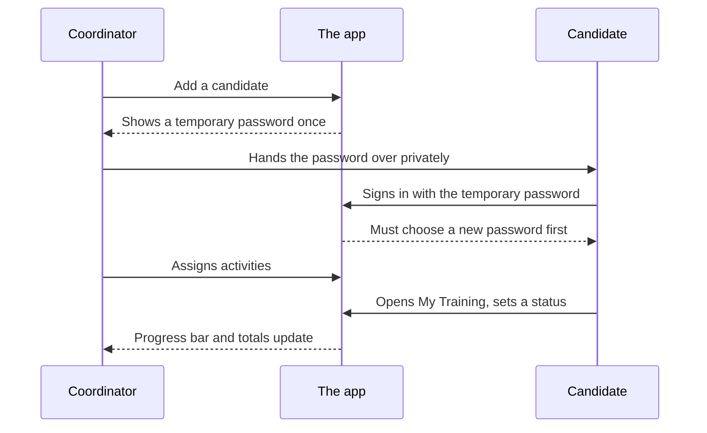

# Overview

This page explains what the Learning Progress Tracker is, who it is for, and what it can and cannot do. Read it first.

## In one paragraph

The Learning Progress Tracker is a website for running a training programme. A **coordinator** (the person in charge) adds **candidates** (the people being trained), gives each one a temporary password, and assigns learning **activities** such as "SQL Fundamentals". Each candidate signs in, chooses their own password, and marks each activity as Not Started, In Progress or Completed. The coordinator sees everyone's progress and the totals for the whole group, which is called a **cohort**.

## The problem it solves

Training managers often track progress in spreadsheets and chat messages. That is slow, easy to get wrong, and hard to keep private. This app gives each person a safe login, keeps one trusted record of who has been assigned what, and shows progress instantly.

## Who uses it

| | Coordinator | Candidate |
| --- | --- | --- |
| How they get an account | Created by the person who runs the server, using a setup script | Created by a coordinator inside the app |
| Can add and edit activities | Yes | No |
| Can add candidates | Yes | No |
| Can reset a candidate's password | Yes | No |
| Can assign activities | Yes | No |
| Can see every candidate's progress | Yes | No |
| Can see cohort totals | Yes | No |
| Can change an activity status | No | Yes, but only their own |
| Can see their own training | Not applicable | Yes |

The important rule is in the last rows. A candidate can only ever see and change their own training. The server enforces this. It is not just hidden on the screen.

## The screens

* **Sign in.** Email and password. The same message is shown for every kind of failure, so nobody can discover which emails exist.
* **Change password.** A new candidate must come here first. Nothing else works until they choose a new password.
* **Coordinator dashboard.** Totals at the top (learners, assignments, completed). Two tabs: Activities and Candidates.
* **Activities tab.** Add and edit activities with a title, a topic and planned hours.
* **Candidates tab.** Add a candidate and see the temporary password once. Pick a candidate to assign activities, see a progress bar, or reset their password.
* **My Training (candidate).** A list of the candidate's activities, each with a status they can change and save.

## The main journey

## The rules of the app

These rules are checked by the server and repeated by the database, so bad data cannot get in.

| Rule | Detail |
| --- | --- |
| Roles | Only two exist: Coordinator and Candidate |
| Email | Must be valid and unique. Capital letters do not make an email different |
| Planned hours | A number above zero, from 0.01 up to 999 |
| Status | One of three words: Not Started, In Progress, Completed |
| Assignments | An activity can be assigned to a learner only once |
| Temporary password | Random, 12 characters, valid for 24 hours, shown only once |
| Password length | At least 10 characters when choosing a new one, and at most 72 bytes |
| Session | You are signed out after 2 hours with no activity |
| Login tries | 10 tries per 15 minutes for each visitor |

## What is included

* Coordinator and candidate accounts with separate permissions
* Safe password handling and first login password change
* Activities, candidates, assignments and progress tracking
* Cohort totals that are always counted from the saved data
* 124 automated tests
* A free live site, plus full setup instructions for your own computer

## What is not included

These were left out on purpose to keep the project focused. They are good ideas for later.

* Email. Starting passwords are handed over by hand, and there is no "Forgot password" email link.
* Deleting candidates or editing their details.
* Two step login (a code from a phone).
* A history log of who changed what.

## Technology at a glance

| Job | Tool |
| --- | --- |
| Screens | React and Vite, styled with Tailwind CSS |
| Server | Node.js and Express |
| Data | PostgreSQL |
| Passwords | bcrypt |
| Tests | Jest and Supertest |
| Free hosting | Render for the server, Neon for the database |

The reasons for each choice are in [Architecture](ARCHITECTURE.md) and [Data model](DATA_MODEL.md).

## Where to go next

* Curious about the questions people ask most? Open the [FAQ](FAQ.md).
* Want to see how it works inside? Open [Architecture](ARCHITECTURE.md).
