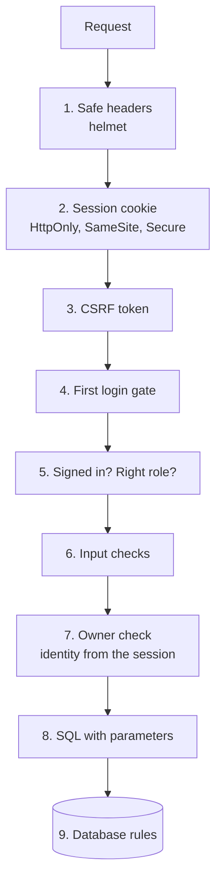

# Security

This page explains the dangers we planned for, how each one is blocked, and what is not covered. Security is built in layers, so if one layer fails, the next one still protects the data.

## The layers

## Threats and defences

| Threat | What it means | Our defence | Where |
| --- | --- | --- | --- |
| Stolen database | Someone copies the data | Passwords are stored only as salted bcrypt hashes, which cannot be turned back into the password | `routes/auth.js`, `learners.js` |
| Guessing passwords | A script tries thousands of passwords | Login is limited to 10 tries per 15 minutes for each visitor. bcrypt is slow on purpose | `routes/auth.js` |
| Finding which emails exist | Different messages reveal valid emails | One message for every failure. A dummy hash makes unknown emails take the same time | `routes/auth.js` |
| Stolen cookie through a script | Bad code on the page reads the cookie | The cookie is HttpOnly, so page scripts cannot read it | `app.js` |
| Cookie sent from another website | Another site makes your browser send requests | SameSite cookies, plus a CSRF token on every change | `app.js`, `csrf.js` |
| Listening on the network | Someone reads traffic on public Wi Fi | HTTPS in production, and the cookie uses the Secure setting there | `app.js` |
| A candidate reading another candidate's data | Changing an id in a request | Identity comes from the session. Ownership is checked on the server and repeated in the SQL | `routes/assignments.js`, `me.js` |
| A candidate using coordinator features | Calling coordinator addresses directly | `requireRole` on the server for every coordinator address | `middleware/auth.js`, `app.js` |
| SQL injection | Input that sneaks commands into a query | Every value is passed as a parameter, never joined into the text | all routes |
| Bad data | Empty names, negative hours | The route checks the input, and the database has CHECK rules as a second guard | routes, `schema.sql` |
| A leaked temporary password | Someone sees it in the browser history | It is shown once, expires in 24 hours, and the answer carries a rule so the browser does not keep a copy | `learners.js`, `app.js` |
| Old sessions after a password change | A stolen session keeps working | Changing or resetting a password ends the other sessions of that account | `auth.js`, `learners.js` |
| Weak first login | A candidate keeps the temporary password | The server allows only a password change and sign out until it is changed | `middleware/auth.js` |
| Browser tricks | Clickjacking and similar | Helmet adds a set of protective headers | `app.js` |

## Passwords in detail

* A **hash** is a scrambled one way copy of a password. A **salt** is random extra data mixed in first, so two people with the same password get different hashes.
* bcrypt is used with cost 12. That means hashing takes a noticeable fraction of a second, which makes guessing very expensive and does not bother a real person.
* New passwords must have at least 10 characters. The most bcrypt can use is 72 bytes, so longer passwords are refused with a clear message instead of being silently cut.
* Temporary passwords are 12 random characters made with the computer's secure random generator.
* Nobody can read a password, including the owner of the server. Recovery always means setting a new one. See the [Admin guide](ADMIN_GUIDE.md).

## Sessions in detail

* A **session** is the server's memory that you are signed in. The browser holds only a random id.
* Sessions are stored in the database, so a server restart does not sign everyone out, and a password reset can really end them.
* The cookie lasts 2 hours after the last activity.
* At login and at password change the server creates a fresh session id. This blocks "session fixation", where an attacker plants a known id before you sign in.

## Rate limiting in detail

* Login and change password are each limited to 10 tries per 15 minutes for each visitor.
* The counter lives in the server's memory. A server restart resets it.
* On the live site the server sits behind helper servers (proxies). The setting `TRUST_PROXY_HOPS` tells Express how many there are, so the limit sees the real visitor and not a helper. If the number is too low, all visitors can look the same, or a different one each time. If it is too high, a visitor can fake their address. On Render the right number is 3, and this was tested on the live site.

## Secrets

* Secrets (`SESSION_SECRET`, `DATABASE_URL`) live in environment variables, never in the code.
* `server/.env` is ignored by Git. Only `.env.example`, which has fake values, is committed.
* If a secret is ever pasted somewhere public, treat it as leaked: create a new one, update it where it is used, and restart. Steps are in the [Admin guide](ADMIN_GUIDE.md).
* Passwords are never written to logs.

## What is not covered

Being honest about limits is part of good security.

* No email, so there is no "forgot password" link. A coordinator who forgets their password needs the server owner.
* No two step login.
* No history log of who changed what.
* The rate limit counter is in memory, so it would not be shared if the app ran on several servers.
* There are no automated browser tests of the screens, only tests of the server.
* This is a training project and has not had a professional security audit.

## Reporting a problem

If you find a security problem, please open an issue on the GitHub repository and describe it in general words. Do not paste real passwords, keys or personal data into an issue.

## Where to go next

* [API reference](API.md) shows which role each address needs.
* [Testing](TESTING.md) lists the tests that check these protections.
