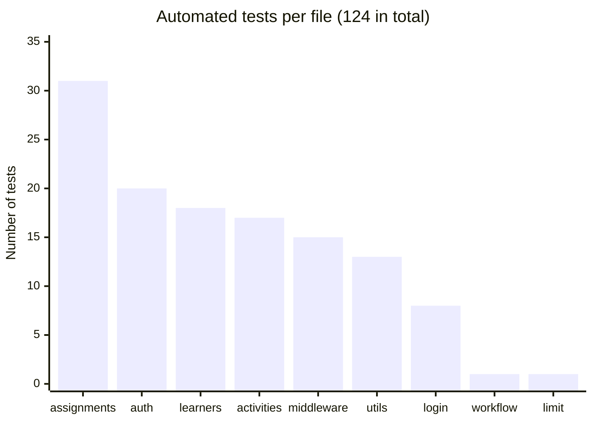

# Testing

An **automated test** is a small program that checks that another program does what it should. We run them after every change. If something breaks, a test fails, and we find out before any user does.

At the time of writing, all 9 test files and **124 tests pass**.

## Run the tests

You need the setup from the main README: the packages installed and a separate test database.

```
cd server
npm run db:init:test
npm test
```

* The first command prepares the test database and asks you to type its name.
* The second command runs everything. It takes about 1 to 2 minutes, because passwords are hashed slowly on purpose.

## A separate database, for safety

Tests erase data between runs. So they use their own database, `lpt_test`, set in `TEST_DATABASE_URL`. The tests refuse to start unless that database name contains the word `test`. Your real data cannot be touched by accident.

## What the tests check

| File | Tests | What it covers |
| --- | --- | --- |
| `assignments.test.js` | 31 | Assigning activities, duplicate assignments, status changes, and a candidate being refused on someone else's training |
| `auth.test.js` | 20 | Login, wrong and expired credentials, the first login lock, change password, logout, session expiry |
| `learners.test.js` | 18 | Adding candidates, validation, duplicate emails in any letter case, password reset, coordinator only access |
| `activities.test.js` | 17 | Adding and editing activities, every validation rule, coordinator only access |
| `unit/middleware.test.js` | 15 | `requireAuth`, `requireRole` and the first login gate, on their own |
| `unit/utils.test.js` | 13 | Id checks and the temporary password maker |
| `unit/login.unit.test.js` | 8 | The login logic with a fake database and a fake password tool |
| `workflow.test.js` | 1 | The whole story from creating a candidate to the cohort totals |
| `rate-limit.test.js` | 1 | The login limit blocks after too many tries |



## Two kinds of tests

* **Integration tests** run the real app against the real test database. They use Supertest, a tool that sends fake web requests to the app without opening a real port. These tests prove the pieces work together.
* **Unit tests** check one small piece alone. They use **mocks**, which are fake stand ins for the database and the password tool, so a failure points to one exact place.

## The important behaviours that are tested

* Required fields and valid values for activities, candidates and assignments
* Duplicate emails, in any letter case, and duplicate assignments
* Wrong, unknown and expired credentials, always with the same generic error
* The first login lock, which allows only a password change and sign out
* Sign out, session expiry and login rate limiting
* Coordinator only actions, and a candidate being refused when they try to read or change another candidate's training
* The whole main workflow, from creating a candidate to the cohort totals

## Quick manual check scripts

The folder `server/scripts/` has small shell scripts that call a running server and print what comes back. They were used while building each phase, and they are handy for a quick look.

```
bash scripts/check-activities.sh COORDINATOR_PASSWORD
bash scripts/check-candidates.sh COORDINATOR_PASSWORD
bash scripts/check-assignments.sh COORDINATOR_PASSWORD
bash scripts/check-candidate-flow.sh COORDINATOR_PASSWORD
bash scripts/check-auth.sh TEMP_PASSWORD NEW_PASSWORD
```

The server must be running first. Use these on your own computer.

## A manual checklist before a demo

1. Sign in as a coordinator. Totals show.
2. Add an activity with 0 hours. An error message appears. Fix and save.
3. Add a candidate. The temporary password panel appears once.
4. Add the same email in capital letters. A message says it is already used.
5. Sign in as the candidate. The password change screen appears first.
6. Assign an activity. Totals update.
7. As the candidate, change a status and save. Refresh. It is still saved.
8. As the coordinator, the progress bar matches.
9. Sign out and try the wrong password. The message is generic.

## What is not tested automatically

* The screens. There are no browser tests, so the screens are checked by hand with the list above.
* Running on several servers at once.

## Where to go next

* [Security](SECURITY.md) explains what these tests protect.
* [Demo script](DEMO.md) turns the checklist into a talk.
